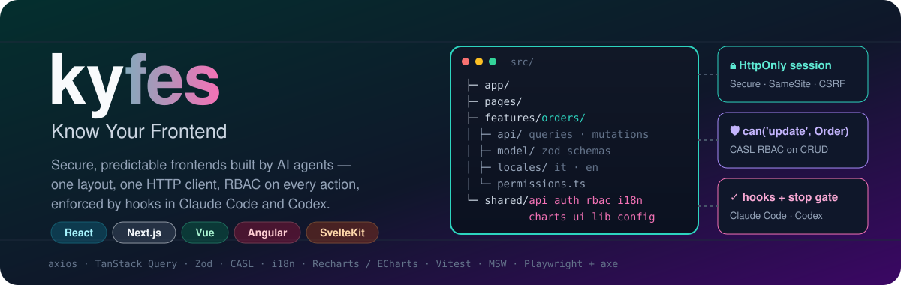
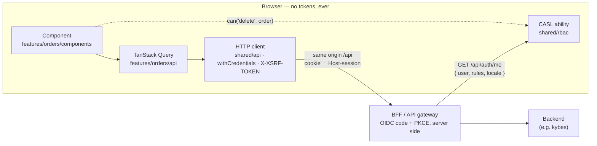
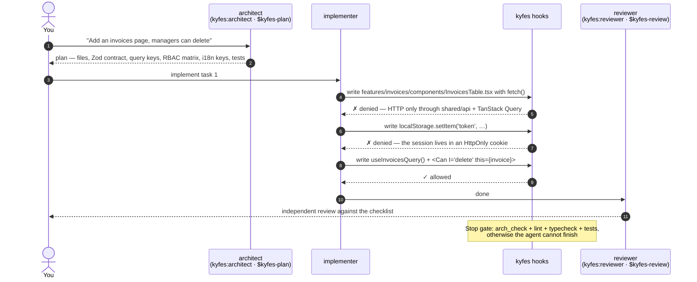

<p align="center">
  
</p>

<p align="center">
  <a href="https://github.com/en1-gma/kyfes/actions/workflows/kit-tests.yml"></a>
  
  
  
  
  
  
</p>

# kyfes — Know Your Frontend

**kyfes is a Claude Code and Codex plugin that makes AI-generated frontends secure and predictable.** Every project gets the same `src/` layout, the same HTTP client, the same way to fetch data, check permissions, translate text and draw charts — in React, Next.js, Vue, Angular and SvelteKit. Every rule that can be checked automatically is enforced by a hook or a CI step, not left to a prompt.

> It is the frontend sibling of [**kybes — Know Your Backend**](https://github.com/ivandilelio/kybes): same philosophy, same API contract (`Page {items, nextCursor}`, errors with `correlationId`), so a kybes backend and a kyfes frontend fit together out of the box.

---

## Why

Ask an agent for "a page that lists orders" ten times and you get ten architectures: a token in `localStorage`, `fetch` inside a component, `if (user.role === 'admin')` next to the delete button, hard-coded Italian strings, a chart library imported in three places. kyfes takes that variance away:

| Problem | What kyfes does |
|---|---|
| Tokens stored in the browser, exposed to XSS | **Cookie-only sessions** (`__Host-session; HttpOnly; Secure; SameSite`) behind a BFF; writes that store tokens, set `document.cookie` or build `Authorization` headers are **rejected** |
| HTTP calls scattered across components | **One client** (axios / Angular `HttpClient`) in `shared/api`, consumed only through **TanStack Query** in `features/<f>/api` |
| Permission checks by role name | **CASL RBAC**: rules come from the server, every CRUD route, button, column and field is gated by `can(action, subject)` |
| Folder structure different every time | A fixed **`app → pages → features → shared`** layout with import direction checked on every write |
| Hard-coded strings, ad-hoc date formats | **i18n** with one namespace per feature and `Intl` formatters |
| Rules forgotten under pressure | **Hooks** deny non-compliant writes; a **stop gate** blocks completion until lint, typecheck, tests and the architecture check pass |

## How it works



### Life of a change with Claude Code or Codex



## One layout, five frameworks

```text
src/
├── app/                      ← bootstrap: providers, router, error boundary
├── pages/                    ← one per route: composes features, no data logic
├── features/
│   └── orders/
│       ├── api/              ← orders.api.ts (Zod-parsed endpoints) · orders.queries.ts · orders.mutations.ts
│       ├── components/       ← OrdersTable, OrderForm, OrdersChart…
│       ├── model/            ← orders.schema.ts (Zod → types)
│       ├── locales/          ← it.json · en.json  (namespace "orders")
│       ├── permissions.ts    ← CASL subject 'Order'
│       └── index.ts          ← the only public entry point of the feature
└── shared/
    ├── api/   auth/   rbac/   i18n/
    └── charts/   ui/   lib/   config/
```

| Layer | React (Vite) · Vue | Next.js | Angular | SvelteKit |
|---|---|---|---|---|
| app | `src/app` | `src/app` (layouts) | `src/app` | `src/hooks*.ts`, `src/routes/+layout.*` |
| pages | `src/pages` | `src/app/**/page.tsx` | `src/app/pages` | `src/routes/**/+page.*` |
| features | `src/features` | `src/features` | `src/app/features` | `src/lib/features` |
| shared | `src/shared` | `src/shared` | `src/app/shared` | `src/lib/shared` |

## The de-facto stack, per framework

| | React | Next.js | Vue 3 | Angular | SvelteKit |
|---|---|---|---|---|---|
| HTTP | axios | axios (+ server `fetch`) | axios | `HttpClient` + interceptors | axios (+ `event.fetch`) |
| Server state | TanStack Query | TanStack Query | TanStack Vue Query | TanStack Angular Query | TanStack Svelte Query |
| RBAC | CASL | CASL | CASL | CASL | CASL |
| i18n | i18next | next-intl | vue-i18n | Transloco | Paraglide JS |
| Charts | Recharts | Recharts | ECharts | ECharts | ECharts |
| Forms / validation | React Hook Form + Zod | React Hook Form + Zod | VeeValidate + Zod | Reactive Forms + Zod | Zod |
| Tests | Vitest · Testing Library · MSW · Playwright + axe | ← same | ← same | ← same | ← same |

Each framework ships a **reference scaffold** with a complete `orders` CRUD feature: cursor-paginated list, form, detail, delete with optimistic update, permission-gated actions and fields, a chart, two locales, MSW mocks with a *manager* and a *viewer* profile, and tests that prove the RBAC matrix.

## RBAC on CRUD, the same everywhere

```tsx
// features/orders/components/OrdersTable.tsx — excerpt from the React scaffold
const { t } = useTranslation('orders')            // from shared/i18n
const can = useCan()                              // from shared/rbac (CASL)
const query = useOrdersInfinite({ status, sort }) // features/orders/api — TanStack Query, cursor pages
const remove = useDeleteOrder()                   // optimistic delete with rollback

const orders = query.data?.pages.flatMap((page) => page.items) ?? []
// ...
{orders.map((order) => {
  const record = orderSubject(order)              // subject('Order', order): conditions on the record
  return (
    <tr key={order.id}>
      <td>{order.number}</td>
      <td className="num">{formatCurrency(order.total)}</td>
      <td>
        {can('update', record) && <Link to={orderPaths.edit(order.id)}>{t('common:actions.edit')}</Link>}
        {can('delete', record) && <Button onClick={() => setToDelete(order)}>{t('common:actions.delete')}</Button>}
      </td>
    </tr>
  )
})}
```

Vue uses `<Can>`/`useAbility()` from `@casl/vue`, Angular the `@casl/angular` signal service, SvelteKit a `Can.svelte` component — always behind `shared/rbac`. Permissions come from `GET /api/auth/me` as CASL rules, are rebuilt when the session changes, and protect routes (`read`), buttons (`create`/`update`/`delete`, with conditions on the record) and single fields. The UI hides — **the server decides**: a 403 refreshes the session and shows a clear message.

## Guardrails

| When | Check | Default |
|---|---|---|
| before every write | tokens/credentials in `localStorage`/`sessionStorage`, `document.cookie =`, `Authorization: Bearer` built in the browser | block |
| before every write | `http://`/`ws://` URLs, raw HTML (`dangerouslySetInnerHTML`, `v-html`, `{@html}`, `innerHTML`, `bypassSecurityTrust*`) without `sanitizeHtml`, `eval`/`new Function`, `target="_blank"` without `rel` | block |
| before every write | secrets in code or `.env`, secrets behind public prefixes (`VITE_`, `NEXT_PUBLIC_`, `PUBLIC_`, `NG_APP_`) | block |
| before every write | `fetch`/axios/`HttpClient` outside `shared/api`; TanStack Query outside `features/*/api`; chart, i18n, CASL and DOMPurify libraries outside their `shared` folder | block |
| before every write | imports against the layer direction, deep imports into another feature, unknown `shared` sub-folders or feature entries | block |
| before every write | role-name checks (`role === 'admin'`, `roles.includes('…')`, `isAdmin`, `hasRole()`) instead of `can()` | block |
| after every write | untranslated visible text, `console.log`, `any`, `@ts-ignore` | warn |
| before finishing (main agent and every subagent) | `arch_check` (incl. duplicated blocks of 8+ lines) + your lint, typecheck and test commands | block |
| in CI | the same checks with `--strict`, `npm audit`, build | fail build |

Every rule can be set to `block`, `warn` or `off` in `.kyfes/config.json` — a file the agent is not allowed to modify. The same Python hooks (standard library only) run in **Claude Code** (`Write`/`Edit`/`MultiEdit`) and **Codex** (`apply_patch`).

## Install

### Claude Code

```text
/plugin marketplace add en1-gma/kyfes
/plugin install kyfes@kyfes
```

Then, inside a project: *"set up kyfes in this project"*. The `kyfes-init` skill detects the framework and runs the installer.

### Codex

```bash
codex plugin marketplace add en1-gma/kyfes
codex plugin add kyfes@kyfes
```

Then: *"Use $kyfes-init to set up kyfes in this project"*. The installer also writes the project-level Codex files (`AGENTS.md` block, `.agents/skills/kyfes-*`, `.codex/agents/kyfes_*.toml`, `.codex/hooks.json`), so teammates get the rules without installing anything. Codex asks you to trust the project and review the hooks the first time.

### Command line

```bash
git clone https://github.com/en1-gma/kyfes
kyfes/install.sh --target /path/to/project --framework react --agents both --scaffold
```

| Option | Values |
|---|---|
| `--framework` | `react`, `next`, `vue`, `angular`, `svelte` (auto-detected from `package.json`) |
| `--agents` | `claude`, `codex`, `both` (default) |
| `--pm` | `npm`, `pnpm`, `yarn`, `bun` (auto-detected from the lockfile) |
| `--scaffold` | copy the reference project (never overwrites existing files) |
| `--ci github\|none`, `--scope`, `--no-plugin`, `--force`, `--uninstall` | |

The installer is idempotent. It creates `.kyfes/config.json`, a versioned copy of the kit in `tools/kyfes/` (used by CI, Codex hooks and teammates), `.claude/rules/kyfes/`, the managed blocks in `CLAUDE.md` / `AGENTS.md` and `.github/workflows/kyfes-check.yml`. Teammates run `tools/kyfes/setup.sh` once to register the Claude Code plugin.

### What you get in each agent

| | Claude Code | Codex |
|---|---|---|
| Rules | skill `kyfes-architecture` + path-scoped rules + `CLAUDE.md` block | skill `$kyfes-architecture` + `AGENTS.md` block |
| Plan | agent `kyfes:architect` | skill `$kyfes-plan`, agent `kyfes_architect` |
| Implement | agent `kyfes:implementer` | agent `kyfes_implementer` |
| Review | agent `kyfes:reviewer` | skill `$kyfes-review`, agent `kyfes_reviewer` |
| Hooks | `PreToolUse`, `PostToolUse`, `Stop`, `SubagentStop` | `PreToolUse` (`apply_patch`), `PostToolUse`, `Stop` |

## The backend contract kyfes expects

| Endpoint | Purpose |
|---|---|
| `GET /api/auth/login?returnTo=/path` | starts OIDC (code + PKCE) on the server, sets `__Host-session` |
| `GET /api/auth/me` | `{ user, rules, locale }` — `rules` are CASL rules |
| `POST /api/auth/logout` | clears the session cookie |
| `POST /api/auth/refresh` *(optional)* | rotates the session; called single-flight on 401 |
| any unsafe method | requires `X-XSRF-TOKEN` = cookie `XSRF-TOKEN` |
| lists | `?limit&cursor&sort` → `{ items, nextCursor, limit }` |
| errors | `{ code, message, correlationId, fieldErrors? }` |

## How kyfes itself is verified

| | Verification |
|---|---|
| Hooks | every rule with its expected outcome (deny/allow) for all five layouts, sent as a Claude Code `Write` and as a Codex `apply_patch`; server-code exceptions (Next route handlers, SvelteKit `+server.ts`); stop gate block → release; duplicate detection |
| Installer | idempotent install, managed blocks, Codex hooks merge, uninstall that leaves your files intact |
| Scaffolds | in CI, for each framework: `npm install`, lint, typecheck, unit/RBAC/i18n tests, production build and `arch_check --strict` with zero findings |

## Documentation

Detailed documentation (Italian) is in [`docs/`](docs/README.md): [architecture](docs/architettura.md) · [security](docs/sicurezza.md) · [data & TanStack Query](docs/dati.md) · [RBAC](docs/rbac.md) · [i18n & charts](docs/i18n-e-grafici.md) · [guardrails](docs/controlli.md) · [configuration](docs/configurazione.md) · [Codex](docs/codex.md) · [roadmap](docs/roadmap.md) · [developing the kit](docs/sviluppo.md).

## A note on security

kyfes enforces the browser half of a secure web app. Cookie flags, CSRF validation, CSP headers, CORS and authorization are ultimately enforced by your server and edge: the docs and scaffolds show the expected configuration, and the reviewer agent checks for it, but they cannot replace a security review of the whole system.

## License

[MIT](LICENSE)
