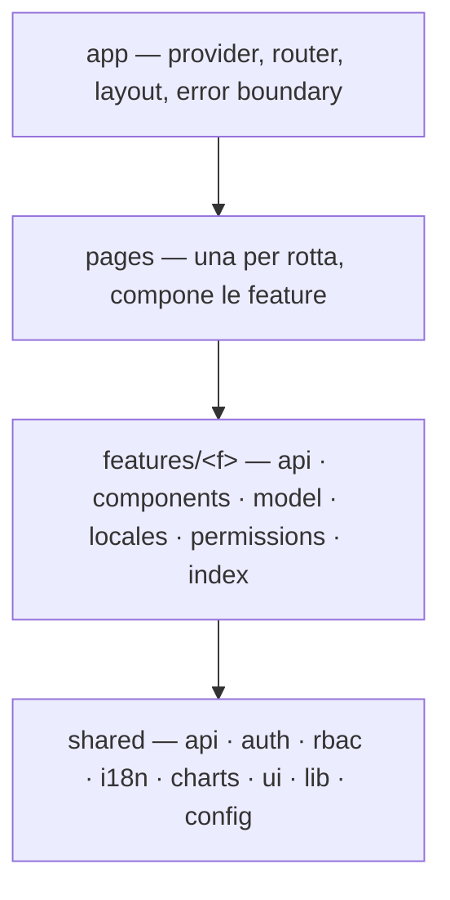

# Architettura

## Quattro livelli, dipendenze verso il basso

- `shared` non conosce le feature. Le feature non conoscono le pagine. Le pagine non contengono logica di dati.
- Una feature si usa solo tramite il suo `index.ts`. Gli import nei file interni di un'altra feature sono rifiutati: se due feature condividono qualcosa, quel qualcosa scende in `shared`.
- In `shared` esistono solo otto sottocartelle. Aggiungerne una è una decisione architetturale, da proporre all'utente.

## Perché questa forma

È la convergenza delle strutture "feature-based" più usate (Bulletproof React, Feature-Sliced Design, la style guide di Angular) ridotta a quattro livelli con nomi fissi. L'obiettivo è lo stesso di kybes: dopo migliaia di file generati da agenti diversi, sapere senza cercare che `features/orders/api/orders.queries.ts` contiene le query degli ordini e che `shared/rbac` è l'unico posto dove si interpretano i permessi.

## Confini delle librerie

| Libreria | Dove si importa |
|---|---|
| axios / `@angular/common/http` | `shared/api` (`HttpClient` anche `app`) |
| altri client HTTP: ky, ofetch, superagent, got, node-fetch, cross-fetch, redaxios, socket.io-client, graphql-request | `shared/api` |
| @apollo/client, urql | `shared/api`, `app` |
| `@tanstack/*-query`, `@tanstack/query-core` | `shared/api`, `shared/auth`, `shared/rbac`, `app`, `features/*/api` |
| swr | `shared/api`, `features/*/api` |
| CASL | `shared/rbac`, `app` |
| i18next, react-i18next, next-intl, vue-i18n, Transloco, Paraglide, react-intl, `@formatjs/*`, `@lingui/*`, svelte-i18n, `@ngx-translate/*` | `shared/i18n`, `app` |
| Recharts, ECharts, vue-echarts, ngx-echarts | `shared/charts` (ECharts anche `app` per la registrazione) |
| Chart.js, layerchart, echarts-for-react, react-chartjs-2, vue-chartjs, `@nivo/*`, victory, apexcharts (e wrapper), highcharts (e wrapper), d3 / `d3-*`, `@visx/*`, plotly | `shared/charts` |
| DOMPurify, isomorphic-dompurify, sanitize-html, xss, insane | `shared/lib` |
| js-cookie, universal-cookie, react-cookie, vue-cookies, ngx-cookie-service, svelte-cookie | da nessuna parte: i cookie li imposta il server |

Gli altri file usano le ri-esportazioni. Cambiare libreria (per esempio da Recharts a ECharts) tocca una sola cartella.

## Mappatura per framework

| Livello | React / Vue | Next.js | Angular | SvelteKit |
|---|---|---|---|---|
| app | `src/app` | `src/app` | `src/app` | `src/hooks*.ts`, `src/app.html`, `src/routes/+layout.*` |
| pages | `src/pages` | `src/app/**/page.tsx` | `src/app/pages` | `src/routes/**/+page.*` |
| features | `src/features` | `src/features` | `src/app/features` | `src/lib/features` |
| shared | `src/shared` | `src/shared` | `src/app/shared` | `src/lib/shared` |

I dettagli (nomi esatti, API, trappole) sono in `plugins/kyfes/skills/kyfes-architecture/references/<framework>.md`.

## Codice server nei framework full-stack

Next.js e SvelteKit hanno anche codice server (route handler, `+server.ts`, `+page.server.ts`, `hooks.server.ts`). Lì `fetch` e l'inoltro di credenziali verso il backend sono legittimi: sono i percorsi `server_globs` della configurazione, esclusi dalle regole "solo browser". Il codice server non viene mai importato dal codice client.
